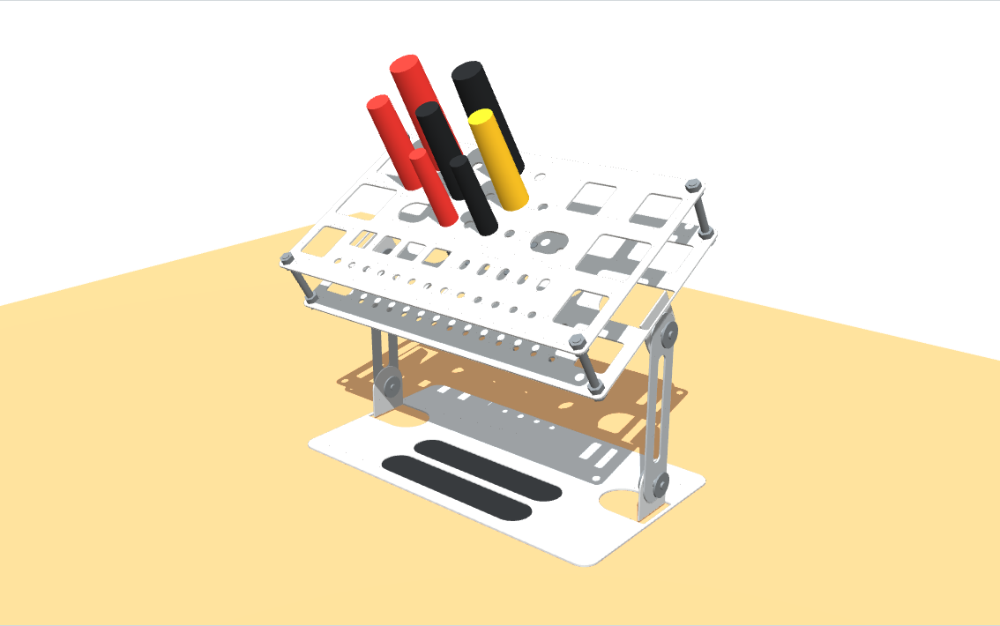
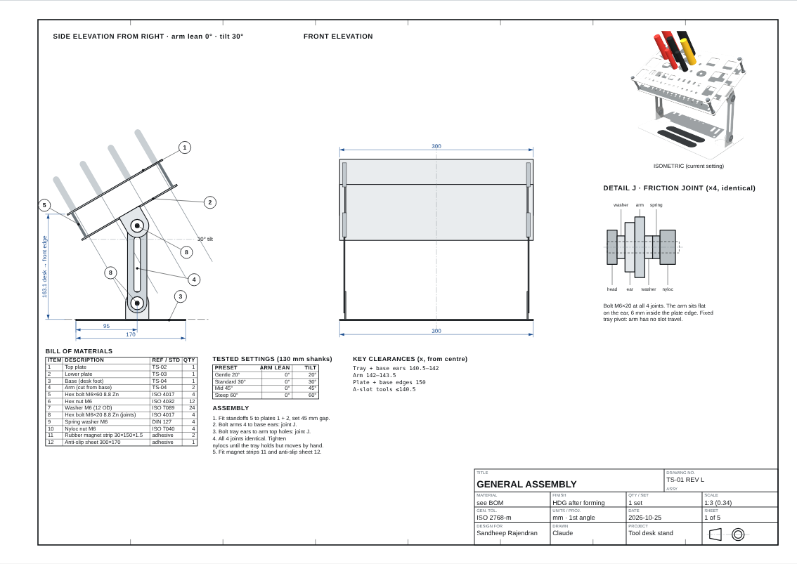
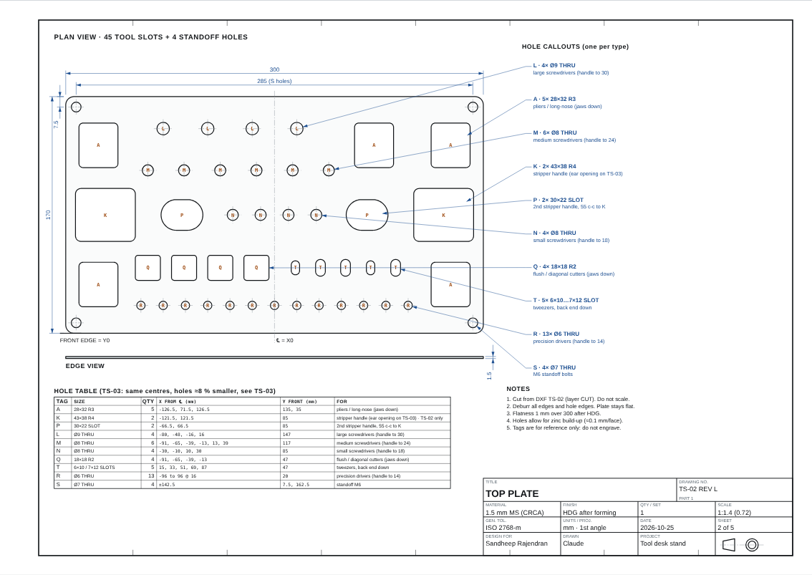
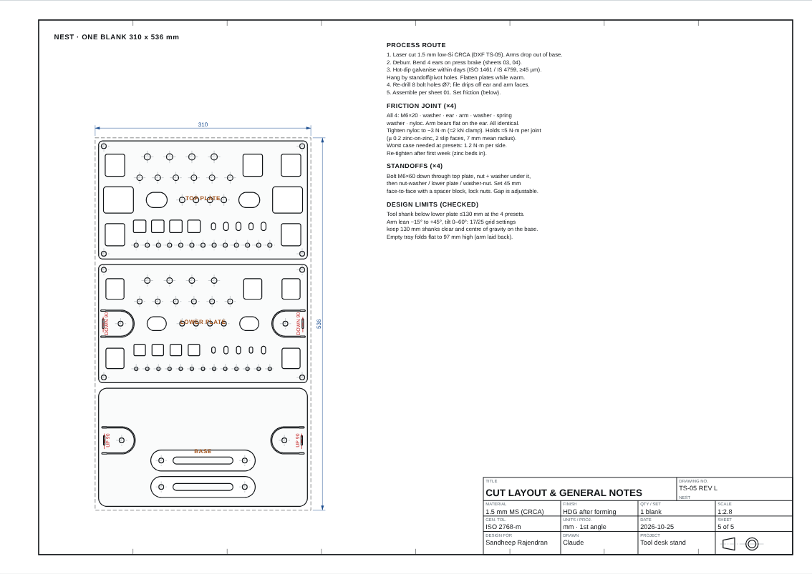
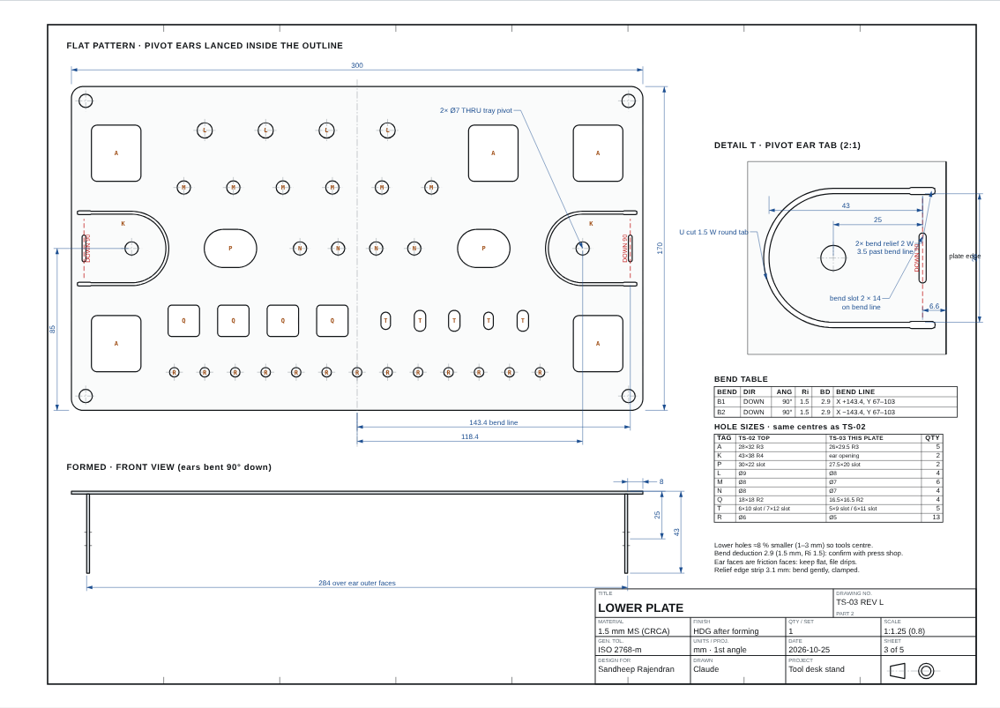
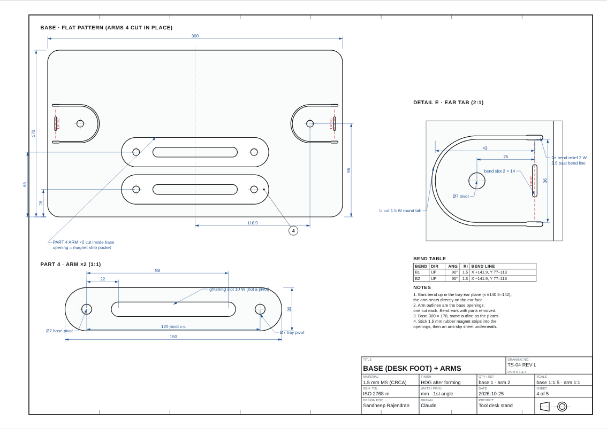

# Sheet-Metal Screwdriver & Tool Desk Stand

A tilting desk stand for screwdrivers, pliers, cutters, strippers and tweezers. It is made from **five flat-cut sheet-metal parts**, all laser-cut from one 310 × 536 mm blank of 1.5 mm mild steel and finished by hot-dip galvanising.

The design aims at low cost:
- No welding.
- Only four bends.
- Both arms are cut from inside the base plate.
- The only bought parts are standard M6 hardware.



**Interactive drawing set:** open [`docs/index.html`](docs/index.html), or the GitHub Pages site if enabled. It contains:

**Live viewer:** https://sandhraj.github.io/sheetmetal-tool-desk-stand/
- a live 3D model with arm-lean and tilt sliders and pass/fail checks;
- five A3 shop-drawing sheets (assembly, top plate, lower plate, base + arms, cut layout) with pan/zoom and layer toggles.

---

## At a glance

| | |
|---|---|
| Footprint | 300 × 170 mm (base = same outline as the tool plates) |
| Tool slots | 45 (pliers, stripper stations, 3 screwdriver sizes, cutters, tweezers, precision drivers) |
| Material | 1.5 mm low-silicon mild steel (CRCA), hot-dip galvanised after forming |
| Cut blank | 310 × 536 mm, one sheet for all parts |
| Steel in parts | ≈ 1.55 kg |
| Bends | 4 × 90° (two hinge ears on the lower plate, two on the base) |
| Adjustment | Tray tilt 0–60° and arm lean, both held by friction joints |
| Tested presets | Gentle 20°, Standard 30°, Mid 45°, Steep 60° (130 mm tool shanks clear the desk) |



## Parts

| # | Part | Qty | Notes |
|---|---|---|---|
| 1 | Top plate | 1 | 300 × 170 flat, 45 tool slots + 4 standoff holes |
| 2 | Lower plate | 1 | Same hole centres, holes ≈ 8 % smaller so tools sit centred; 2 pivot ears lanced inside the outline and bent down |
| 3 | Base (desk foot) | 1 | 300 × 170, 2 pivot ears lanced and bent up |
| 4 | Arm | 2 | 150 × 30, pivot holes 120 mm c-c, lightening slot (not a pivot); cut from inside the base |

### Bought hardware (all M6)

| Item | Qty | Use |
|---|---|---|
| Hex bolt M6 × 60 | 4 | Standoffs between the two tool plates (45 mm face-to-face) |
| Hex bolt M6 × 20 | 4 | Friction joints (arm ↔ ears) |
| Hex nut M6 | 12 | Standoffs (3 per corner) |
| Plain washer M6 | 24 | Standoffs (16) + joints (8) |
| Nyloc nut M6 | 4 | Friction joints |
| Spring washer M6 | 4 | Friction joints |
| Flexible magnet sheet 1.5 mm | 2 strips 30 × 150 | Drop into the arm openings in the base (parts tray) |
| Self-adhesive anti-slip foam/rubber | 300 × 170 | Under the base |

All fasteners are sold singly at Indian online fastener stores such as [OnlyScrews](https://onlyscrews.in/). The set costs roughly ₹90 at the time of writing.

## Tool slot layout



| Tag | Slot (top plate) | Qty | For |
|---|---|---|---|
| A | 28 × 32 R3 | 5 | Pliers / long-nose (jaws down) |
| K + P | 43 × 38 + 30 × 22 slot, 55 mm c-c | 2 pairs | One stripper per station, one handle in each |
| L | Ø9 | 4 | Large screwdrivers (handle ≤ 30) |
| M | Ø8 | 6 | Medium screwdrivers (handle ≤ 24) |
| N | Ø8 | 4 | Small screwdrivers |
| Q | 18 × 18 R2 | 4 | Flush / diagonal cutters (jaws down) |
| T | 6 × 10 / 7 × 12 slots | 5 | Tweezers (back end down) |
| R | Ø6 | 13 | Precision drivers |

The lower plate uses the same centres with each hole about 8 % smaller (1–3 mm), so tools are centred by the lower plate.

## Fabrication



1. **Laser cut** `dxf/TOOL_STAND_NESTED_ALL_PARTS.dxf`, or the per-part files, from 1.5 mm low-silicon CRCA. Layers:
   - `CUT`: cut these lines.
   - `BEND`: bend lines, marked only.
   - `LABEL`: notes, do not cut.
2. **Deburr**, then **bend** the four ears 90° (lower plate: down; base: up).
   - The generator assumes a bend deduction of **2.9 mm** (1.5 mm sheet, Ri 1.5).
   - **Confirm this with your press-brake shop.** If it differs, change `BD` in `src/tool_stand.py` and regenerate.
3. **Hot-dip galvanise** within a few days of cutting (ISO 1461 / IS 4759).
   - Hang the parts from the standoff or pivot holes.
   - Ask the galvaniser to flatten the plates while warm.
4. **Clean up:** re-drill the 8 bolt holes Ø7 and file zinc drips off the ear and arm faces (these are the friction faces).

Lower plate (left) and base + arms (right):

| | |
|---|---|
|  |  |

## Assembly

1. Fit the four standoffs between the top and lower plates and set them 45 mm face to face.
   - Bolt goes down through the top plate.
   - Nut and washer under the top plate.
   - Then nut, washer, lower plate, washer, nut.
2. Bolt each arm to its base ear (bottom hole) and to its tray ear (top hole). All four joints are identical:
   - M6 × 20 bolt
   - washer
   - ear
   - arm
   - washer
   - spring washer
   - nyloc nut
3. Tighten the nylocs (≈ 3 N·m) until the tray holds with tools in but moves under a firm push. Re-tighten after the first week, once the zinc has bedded in.
4. Stick the magnet strips into the arm openings and the anti-slip sheet under the base.

## Design checks

These are computed by the generator, not measured on a built part:
- Tool shanks up to **130 mm below the lower plate** clear the desk at all four presets.
- The centre of gravity stays 39–72 mm inside the 170 mm base at the presets.
  - Don't lean the arms forward.
  - The front edge of the tray overhangs the base by about 10 mm.
- Friction needed is ≤ 1.1 N·m per side, against an estimated ≈ 5 N·m grip per joint.
- Top-plate sag with 1.5 kg of tools is estimated at under 1 mm.

## Regenerating the files

Everything is parametric (sizes, hole layout, thickness, bend deduction):

```bash
cd src
pip install ezdxf shapely matplotlib
python tool_stand.py        # writes build/*.dxf and build/geometry.json, prints a check report
python export_solids.py     # writes build/solids.json for the 3D viewer
python build_drawings.py    # rebuilds docs/index.html from drawing_template.html
cp build/*.dxf ../dxf/
```

## Repository layout

```
dxf/      Cut files (nested sheet + one file per part), layers CUT / BEND / LABEL
docs/     Interactive drawing set + 3D viewer (index.html, GitHub Pages ready)
images/   Renders of each drawing sheet and the 3D model
src/      Parametric generator (Python) and drawing template
```

## Disclaimer

This is a hobby design. The dimensions were checked in code, but **no physical prototype has been verified yet**. Check the bend deduction with your fabricator, and test-fit your own tools against a paper print of the top plate before cutting.

## License

- Code in `src/`: MIT (see `LICENSE`).
- Design files (`dxf/`, `docs/`, `images/`): CC BY 4.0 (see `LICENSE-DESIGN.md`).
